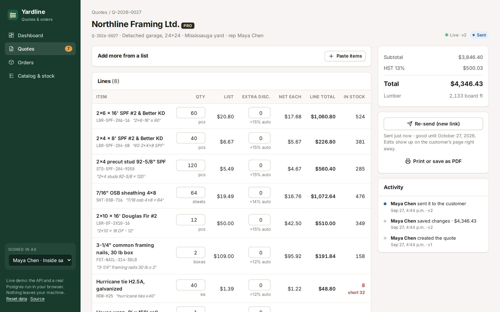
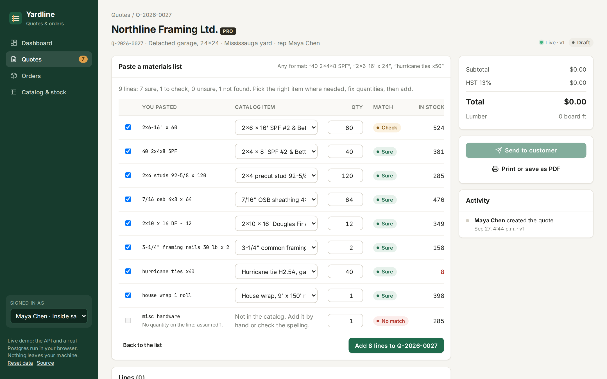
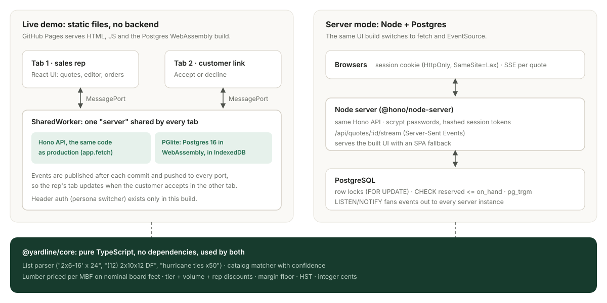

# Yardline

[](https://github.com/DilpreetBansi/yardline/actions/workflows/ci.yml)

Quoting and ordering for building-supply yards. A contractor texts a messy materials list; the rep pastes it in, gets a priced quote in seconds, sends the customer a link, and turns the accepted quote into an order that reserves stock.

**[Live demo →](https://dilpreetbansi.github.io/yardline/)** The API and a real Postgres run inside your browser, so there is nothing to sign up for and nothing leaves your machine. Open the customer link in a second tab and watch the rep's tab update when you accept.



## What it does

1. **Paste a list in any shape.** `40 2x4x8 SPF`, `2x6-16' x 24`, `(12) 2x10x12 DF`, `5/8 type x drywall 4x8 - 60 sheets`, `hurricane ties x50`, `two rolls 6 mil poly`. Each line is parsed into size, length, species, thickness, pack and quantity, then matched to the catalog with a confidence level. Lines that could mean two things (no species, no length) are flagged instead of guessed. `300 lf 2x4` becomes 19 pieces at 16'.
2. **Price it like a yard does.** Lumber is priced per thousand board feet on nominal sizes. Contractor and pro tiers, a lumber volume break at 1,000 board feet and a sheet-goods break at 50 sheets apply automatically. A rep's extra discount past their limit, or any net price under cost + 10%, needs a manager's approval before the quote can go out. Ontario HST on top.
3. **Send a link.** The customer sees their prices (never costs or internal notes), can accept by typing their name, or decline with a reason. The link is good for 30 days.
4. **Order it.** An accepted quote becomes an order in one transaction that reserves the stock at that yard.



## How it's built



The same Hono API runs in two places. In production it is a Node server on Postgres. For the live demo it runs in a **SharedWorker** on [PGlite](https://pglite.dev) (Postgres compiled to WebAssembly, stored in IndexedDB), so every tab talks to the same database and gets the same events. The UI is one React build that picks its transport.

- `packages/core`: parser, matcher and pricing. Pure TypeScript, no dependencies, no I/O.
- `packages/api`: the Hono app, SQL migrations, services, seed data, and a `Db` interface with a PGlite driver.
- `apps/server`: node-postgres driver, password sign-in, Server-Sent Events, LISTEN/NOTIFY.
- `apps/web`: React 19, React Router, TanStack Query, and the demo worker.

### Engineering notes

- **No lost updates.** Every save sends the version the user was looking at. A stale save gets `409` and the editor offers to load the other person's changes instead of overwriting them. The customer's accept is pinned to the version they saw, so a rep's last-minute edit can't be accepted by accident.
- **No overselling, no double orders.** Converting to an order locks the inventory rows in a fixed order (`SELECT … FOR UPDATE`, so two orders serialize instead of deadlocking), checks availability, and reserves stock in the same transaction. A `CHECK (reserved <= on_hand)` constraint backs that up. The endpoint requires an `Idempotency-Key`; retries, including concurrent ones, get the first order back. Both are tested against real Postgres with racing transactions.
- **Events only after commit.** Changes are written to `quote_events` inside the transaction and published only once it commits, so a rolled-back write never shows up on anyone's screen. The server fans events out across instances with `LISTEN/NOTIFY` and streams them to browsers over SSE.
- **Secrets are hashed.** Share links and session tokens are long random values; only their SHA-256 is stored. Passwords use scrypt. Session cookies are `HttpOnly` and `SameSite=Lax`.
- **Money is integer cents.** Each line rounds once (net unit price), line totals are exactly `qty × unit`, and tax rounds once on the subtotal. Property tests check that lines always add up, that a better tier never costs more, and that anything under the margin floor is always flagged.

## Tests

| Suite | Runs on | What it covers |
| --- | --- | --- |
| `packages/core/test` (85) | Node | 34 real-world list formats, matching and confidence, board-foot pricing, property tests on pricing invariants (fast-check) |
| `packages/api/test` (21) | PGlite | every endpoint: auth, version conflicts, approvals, share links, expiry, idempotent orders, stock shortfalls, events only after commit, fuzzy search |
| `apps/server/test` (4) | PostgreSQL 16 | two orders racing for the last 12 boards, five concurrent retries with one key, sign-in, SSE |
| `e2e` (5) | Chromium | the whole flow across two tabs in the demo build; stale edit; manager approval; fuzzy search; server mode with sign-in and live updates over SSE |

```sh
npm ci
npm test                         # core + API on PGlite; the Postgres tests run when DATABASE_URL is set
DATABASE_URL=postgres://… npm test
npm run build && npm run build:server
npm run test:e2e                 # demo e2e; server e2e too when DATABASE_URL is set
```

## Running it

The demo, fully in the browser:

```sh
npm ci
npm run dev                      # http://localhost:5173/yardline/
```

Server mode, against your own Postgres 16:

```sh
npm run build:server
DATABASE_URL=postgres://postgres@localhost:5432/yardline YARDLINE_DEMO_PASSWORD=yardline-demo npm start
# http://localhost:8787 · sign in as maya@yardline.test, daniel@yardline.test or sam@yardline.test (manager)
```

`YARDLINE_DEMO_PASSWORD` only sets a password for the seeded staff accounts that have none; leave it unset in real use. `SECURE_COOKIES=1` marks the session cookie `Secure` behind HTTPS.

The catalog, prices and customers are made up for the demo, and the six weeks of history are generated through the same API calls a user would make. Requires Node 22.18+ (the server runs TypeScript directly with Node's type stripping).

## License

MIT
